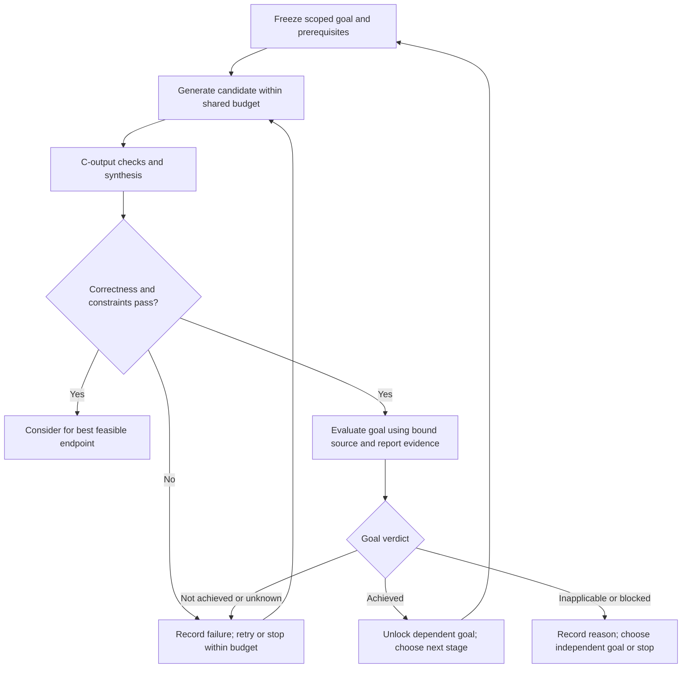

# Multi-step verification, historical mode comparison, and AutoDSE

Investigation completed September 29, 2026. This records findings and a proposed
extension; it does not implement goal gating or launch a new experiment.
Production code, frozen campaign sources, raw outcomes, and live backfill jobs
were not changed. The manuscript received factual description corrections.

## Decision

Pursue explicit architectural goal verification as a separate, measurable
extension. Do not claim the existing multi-step mode already enforces it.
Use the September 25 matched-parent cohort for diagnosis, then a new experiment
with consistent prompts and controlled search opportunities. Investigate the
stock UCLA AutoDSE implementation through a bounded compatibility gate before
allocating a comparison campaign.

The current mode distinction is **rewrite scope and state progression**:
flash requests a complete endpoint rewrite, while multi-step carries accepted
changes into later targeted stages. Both use candidate evaluation and optional
QoR review. Flash retries can also consume previous code and reports. It is
incorrect to equate flash with one model call, or multi-step with unique access
to validation or feedback.

## What the controller currently establishes

The [implementation audit](multistep_goal_verification_audit_20260929.md)
provides file/line evidence and two deterministic sanity checks.

- Candidate CSim/synthesis checks establish tested behavior and configured
  feasibility. They do not establish universal equivalence, every architectural
  goal, or RTL correctness when co-simulation was disabled.
- The optional `profile_skill_tradeoff_v1` reviewer is deterministic; it does
  not make another model call. It measures aggregate QoR and looks for source
  markers and persistent bottlenecks. It explicitly records that recipe
  correctness and per-skill causality are not proven.
- A faster candidate can be accepted although the intended loop still misses
  its II target. A synthetic 100→80-cycle example with unchanged target II=4
  confirms that no review retry is requested. This is a behavior check, not a
  measured failure rate across benchmarks.
- The router's `completed` list includes failed visits. Failed visits do not
  overwrite the accepted source. Rename this meaning to `visited` in future
  telemetry and add separate achieved/blocked/unknown states.
- Legacy `verified_applied_skill_ids` is source-marker credit. Its detector
  even credits a comment-only pragma in the synthetic check; the newer QoR
  reviewer correctly strips comments. Neither is a hardware proof.
- There is a confirmed instruction conflict: the shared system prompt permits
  only one technique while the flash user prompt permits combinations. The
  archived ATAX flash repeat-1 transcripts confirm it in both reviewer arms.
  Its performance impact is unknown. A consistent mode-specific prompt must be
  frozen in a new cohort; old results must not be silently relabeled or rerun.

## Historical comparison: useful, but not a clean mode-effect experiment

The [derived audit](../artifacts/sigmetrics2027/mode_audit_20260929/report.md)
and [summary](../artifacts/sigmetrics2027/mode_audit_20260929/summary.json)
cover 324 registered runs: 27 kernels × flash/dynamic × reviewer-off/on ×
three API samples. There are 323 audit-valid run records and 161 usable
cross-mode pairs after one existing audit exclusion. Parent code/report,
model, tool/clock, input identity, and knowledge settings match within pairs.
All endpoint numbers below are **CSim/CSynth-feasible synthesis estimates**,
including retained starting designs, not independently RTL-validated latencies.

The ratio is flash estimated cycles divided by dynamic estimated cycles;
values above one favor dynamic. Geometric means and intervals below weight
benchmarks equally; intervals resample 27 benchmark clusters 10,000 times.

| Reviewer setting | Pairs | Dynamic wins / ties / flash wins | Dynamic ratio, 95% interval | Mean model calls: flash / dynamic | Mean synthesis calls: flash / dynamic |
|---|---:|---:|---:|---:|---:|
| Off | 81 | 37 / 8 / 36 | 1.367 [0.777, 2.501] | 2.04 / 4.98 | 1.69 / 3.86 |
| On | 80 | 39 / 1 / 40 | 0.879 [0.486, 1.596] | 2.07 / 5.00 | 1.79 / 3.53 |

The second row's pair-weighted mean is 0.885; the small difference from 0.879
comes from one benchmark having only two valid paired repeats. Use one declared
weighting consistently. Cost means include all 81 scheduled runs per cell;
paired effect estimates use only audit-valid pairs. Do not conceal the excluded
record or equate audit eligibility with new functional validation.

This does not show a robust general multi-step advantage. It also does not
show that multi-step cannot help particular kernels. Shared five-call caps
still permitted about twice as much realized model effort in dynamic mode.
Reviewer-on additionally bundles tradeoff guidance with review feedback, so it
is not an isolated test of review or of enforceable goals. Three samples are
separate requests, not guaranteed distinct or API-seeded at temperature zero.

A retrospective two-call truncation is retained as a diagnostic in the derived
summary. It is not a prospectively optimized two-call policy: routing, stopping,
and prompts were chosen for the original horizon. Do not promote it to a fair
new experiment or use its confidence interval as causal evidence.

No run has the proposed typed goal contract. An inspected GEMM dynamic/review-on
trajectory accepted a step while a declared partition recipe had no static
family evidence and the target was no longer reported after scope changes.
The reviewer explicitly did not prove resolution. This is a concrete case for
scope binding and an `unknown` verdict, not evidence of a verified goal.
Successful dynamic stages can also increase latency temporarily. Reconstruct
best-so-far curves from eligible candidate events plus the frozen parent;
the saved history named `best_so_far_history` is not necessarily monotone.

## Proposed per-step contract and controller behavior

One architectural goal can require several coordinated edits. Do not encode
“one step” as “one pragma”: matching banking to replicated compute lanes may
require a joint change. Likewise, an enabling step need not lower total cycles
immediately. Distinguish a structural prerequisite from the final latency goal.

Before generation, freeze:

```
StepGoal
  id, schema_version, parent_source_hash, parent_report_hash
  target_scope, source_to_report_mapping, tool/part/clock/input_identity
  intended_effect, predicate(metric, operator, threshold), required_evidence
  dependencies, correctness/interface invariants, retry allowance
```

After evaluation, record the candidate/report hashes, observed metric and raw
witness location, scope-match status, goal verdict, correctness/feasibility,
resource/latency changes, and chosen controller action. Verdicts distinguish
`achieved`, `not_achieved`, `unknown`, `not_applicable`, and
`blocked_by_constraint`. Missing diagnostics or a renamed unmatched loop must
produce `unknown`; absence of a warning does not certify resolution.

| Intended effect | Required witness | What cannot prove it |
|---|---|---|
| Pipeline a named loop | Achieved loop II against a justified target; matched scope and schedule evidence | PIPELINE text or top-level transaction interval |
| Remove an operand-supply limit | Bank/storage binding plus concurrent address/port demand and relevant schedule change | Partition pragma or higher DSP count |
| Increase useful parallel work | Compiler-realized unroll factor and loop schedule, operand supply, resource costs | Requested unroll factor alone |
| Reduce external traffic | Named interface/burst or transaction evidence under fixed inputs | Wider type declaration or buffer variable name |
| Overlap stages | Process/channel schedule or RTL trace showing concurrency; correct boundaries/ownership | DATAFLOW keyword or two allocated buffers |

Reuse `hls_feedback.py` loop `PipelineII` and realized pipeline/unroll log
records first. Array binding, traffic, and overlap checks need additional
instrumentation where reports do not already supply witnesses. Do not promise
complete automatic verification of arbitrary source rewrites.



Keep the active exploration source separate from the best feasible endpoint.
A faster design can remain an endpoint candidate even when its intended goal
failed; it must not earn goal credit or unlock dependent steps. Permit bounded,
feasible enabling regressions. Every retry consumes the existing run budget;
reaching the retry limit records an unmet/unknown goal, not success.

## Experiments to separate the claims

1. **Offline shadow review, zero model/HLS calls.** Reconstruct parent→candidate
   edges in the saved cohort. Stratify faster/slower/invalid candidates,
   reported/unreported bottlenecks, and source markers with/without compiler
   witnesses. Human-check a sample without choosing only success stories.
   Report verifier coverage and false positive/unknown rates where labels exist.
2. **Correct treatment definitions.** Version the flash system prompt, separate
   route visitation from goal completion, and replace misleading marker labels.
   Test missing/wrong-scope evidence, enabling regressions, retry exhaustion,
   and complete rollback of source/report/validation state before a campaign.
3. **Mode comparison.** Hold recipe representation and reviewer policy fixed.
   Register a fixed-parent, complete-rewrite flash baseline with up to five
   generation calls against five targeted evolving-source calls. Define repair
   spending identically within the same total calls/syntheses, timeouts and
   token limits. This new fixed-parent baseline must have a distinct ID from
   historical two-attempt flash. Report actual use and quality-versus-cost
   curves, not just nominal caps.
4. **Goal-control comparison within multi-step.** Compare the same verifier
   evidence supplied as advice versus used to gate dependency advancement.
   Holding review text and predicate generation fixed isolates control-flow
   enforcement. A no-review arm separates feedback from enforcement. If a
   mode×review factorial is added, flash must receive comparable endpoint-goal
   evidence; otherwise information access is another changing factor.
5. **Validation and metrics.** Use frozen public parents, independent repeat
   requests, the same five RTL cases, and no post-RTL reselection. Report valid
   outcome yield, improvements versus retained parents, paired cycle ratios
   and benchmark uncertainty, achieved/unknown goals, resources/timing, tokens,
   charges, synthesis work and elapsed time. Checkpoint curves are synthesis
   estimates unless every plotted checkpoint has RTL validation.

Keep the registered 216-cell guidance-representation study separate. Its
six-cell pilot explicitly uses flash and disables QoR review; its three arms
cannot establish a mode or goal-verification effect. Any extension changes the
registration and projected costs and must have its own manifest. It need not
multiply every new factor into the entire original matrix before a small
engineering and verifier-calibration pilot succeeds.

## AutoDSE: relevant baseline, installation gate still open

The [full feasibility audit](autodse_feasibility_20260929.md) inspects the
[UCLA-VAST implementation](https://github.com/UCLA-VAST/AutoDSE) at commit
`bfc37862d1b9c6bf69cc7763ffdcfaa1fabd6c50` and the
[authors' paper](https://arxiv.org/pdf/2009.14381v2).
AutoDSE already combines bottleneck-guided iteration with Merlin source
transformations. Our distinction cannot be iteration or source rewriting alone.
The open research question is whether model-proposed changes and explicit
scoped goals improve validated outcomes per unit search cost over the compiler's
supported design space.

The stock tool is not ready here: Merlin was not found, the documented container
requires `merlin:latest`, current-user Docker access is unavailable, and its
analyzer needs Merlin hierarchy/topology/performance reports. A direct raw-Vitis
adapter is a substantial port, not a command substitution. Native installation
is possible in principle but has not been shown compatible with this host.

The concrete sequence is:

1. Time-box Merlin compatibility investigation to one engineering day. Use one
   upstream MVT design, one worker, isolated scratch and Redis; require generated
   source and parsable reports before a search. Do not disturb live workers.
2. Pilot MVT (double, N=120) and MachSuite GEMM (double, 64×64), whose upstream
   and local shapes match. Freeze semantic adapters and common kernel boundaries
   and inputs; shape matching alone is not equivalence. These pilots do not
   silently replace the registered core benchmark set.
3. Compare common plain parent, Merlin-only, and Merlin+AutoDSE to expose backend
   versus search effects. A proposed ten-evaluation/60-minute pilot is an
   engineering check, not a competitive final-budget result. Count profiling
   and scope-map HLS jobs as well as candidate evaluations.
4. Validate the frozen selected source using the common five-case oracle/RTL
   harness where faithful adaptation is possible. Report native and common
   backend measurements separately if versions differ. AutoDSE's resource-valid
   flag is not our correctness criterion.
5. If the stock backend cannot pass the gate, report the specific blocker and
   use the planned common-Vitis deterministic parameter baseline. Label any
   reimplementation “AutoDSE-inspired”; do not call it the authors' implementation.

The upstream launcher can flush its Redis database and uses host networking;
a dedicated Redis instance is necessary. Its sample exploration timeout is
1,200 **minutes** and default parallelism can exceed the intended pilot; freeze
explicit limits. Model-call equality is inapplicable to a zero-LLM baseline:
compare compiler work, end-to-end time, validated quality and hardware cost.

## Current state and deliverables

At September 29, 15:30 CDT, the unchanged historical backfill had **258/405
finished: 213 pass, 18 fail, 27 timeout; four active and 143 queued**.
The [snapshot](../artifacts/sigmetrics2027/status/20260929T203031018901Z/report.md)
records the read window. This progress is separate from the mode investigation.

The SIGMETRICS manuscript compiles with 19 technical pages (21 total), 10
figures, 9 tables, and 1 algorithm; all previous labels remain and there are
no unresolved references or overfull boxes. It now qualifies flash retries, distinguishes shared
candidate review from goal verification, and accurately describes AutoDSE's
compiler transformations. Historical results and original HPCA source are
preserved. The new goal mechanism and AutoDSE experiments remain proposed;
no installation, paid request, production-code change, or new Vitis job was
performed for this investigation.


## Source-backed case follow-up

The [BICG/ATAX narrative and goal audit](sigmetrics_mode_case_narrative_20260929.md)
now supplies exact source/report/prompt evidence for one multi-step-winning and
one median flash-winning pair, complete repeats, and counterexamples. A
standalone offline checker evaluates manually bound compiler metrics as
achieved/unmet/unknown; it does not change the production reviewer or enforce
prerequisites. Its twelve diagnostic probes and ten focused tests establish
basic evidence-handling behavior, not a measured mode benefit. The proposed
consistent-prompt/equal-opportunity experiment remains unlaunched and separate
from the registered representation study.
